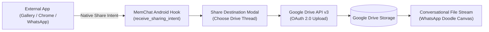

# 💬📁 MemChat — Conversational Cloud Storage & Android Share Companion

[](https://flutter.dev/)
[](https://dart.dev/)
[](https://developers.google.com/drive)
[](https://riverpod.dev/)
[](website/app/memchat.apk)
[](LICENSE)

> **Reimagining personal cloud storage: Turn Google Drive into a sleek, WhatsApp-styled conversational workspace with instant native Android share intent interception and zero proprietary lock-in.**

---

## 📲 Quick Download

🚀 **Ready to test on your Android device?**
- **Direct APK**: [Download MemChat APK (`website/app/memchat.apk`)](website/app/memchat.apk)
- **Web Landing Page**: Open `website/index.html` to explore the interactive showcase.

---

## 🌟 The Philosophy: Why MemChat?

Traditional cloud storage apps (Google Drive, Dropbox, OneDrive) force users into deeply nested, bureaucratic directory trees. On mobile devices, organizing files into folders feels slow, tedious, and disconnected from the natural way people communicate.

**MemChat completely rethinks personal file management by treating Google Drive like WhatsApp**:
- 💬 **Folders are Chat Threads**: Every folder on your Google Drive is represented as a conversational contact/group.
- 📄 **Files are Chat Messages**: Uploading a document, image, or invoice is as simple as sending a chat message bubble.
- 🚀 **Native Android Share Interception**: Tap "Share" on any photo, PDF, or video in WhatsApp, Instagram, or Chrome, and immediately forward it straight into your designated MemChat thread.
- 🔒 **Zero Vendor Lock-in**: All files remain stored in your personal Google Drive in standard directories. If you uninstall MemChat, all your files remain accessible on drive.google.com!

---

## ✨ Feature Highlights



- 🎨 **WhatsApp Dark Mode Aesthetic**:
  - Authentic dark theme with custom WhatsApp doodle wallpaper (`whatsapp_doodle_background.dart`).
  - Chat list screen with last modified timestamps, file counts, and folder icons.
  - Interactive file bubbles with thumbnail caching via `cached_network_image`.
- ⚡ **Direct File Interaction**:
  - Integrated native file opener via `open_filex` to launch PDFs, spreadsheets, and media in your preferred viewers.
- 📱 **Seamless Native Sharing**:
  - Background share receiver configured in `MainActivity.kt` and `share_intent_service.dart`.
  - Destination picker popup lets you organize incoming files into threads in 2 taps.
- 🌐 **Companion Landing Page & Web Showcase**:
  - Shipped with a clean landing page located in `website/` with interactive mockup previews.

---

## 🏗️ Project Architecture

```
MemChat/
├── lib/
│   ├── main.dart                          # App bootstrap & theme initialization
│   ├── models/
│   │   └── drive_item.dart               # Google Drive file & folder data models
│   ├── screens/
│   │   ├── splash_auth_screen.dart       # Google OAuth login & token verification
│   │   ├── chat_list_screen.dart         # List of Drive folders as chat conversations
│   │   ├── chat_thread_screen.dart       # Conversational file stream & upload bar
│   │   └── share_destination_modal.dart  # Modal dialog for incoming Android shares
│   ├── services/
│   │   ├── google_auth_service.dart      # Google Sign-In & credential management
│   │   ├── google_drive_service.dart     # Google Drive v3 REST API operations
│   │   └── share_intent_service.dart     # Native Android share intent listener
│   ├── theme/
│   │   └── app_theme.dart                # Dark palette & WhatsApp styling constants
│   └── widgets/
│       ├── file_bubble.dart              # Interactive file preview message bubble
│       └── whatsapp_doodle_background.dart # SVG/Vector doodle background pattern
├── website/                               # Companion website & APK distribution
│   ├── index.html                        # Showcase landing page
│   ├── style.css                         # Dark mode styles & animations
│   ├── script.js                         # Interactive phone mockup logic
│   └── app/
│       └── memchat.apk                   # Pre-compiled Android release binary
├── pubspec.yaml                          # Dependencies & Flutter configuration
└── README.md
```

---

## 🚀 Getting Started

### Prerequisites
- **Flutter SDK** (>= 3.11.5)
- **Dart SDK** (>= 3.x)
- Android Studio / VS Code with Flutter extensions
- A Google Cloud Project with the **Google Drive API v3** enabled

### 1. Google Cloud Console Setup
1. Visit the [Google Cloud Console](https://console.cloud.google.com/).
2. Create a project and enable the **Google Drive API**.
3. Configure the **OAuth Consent Screen** (Scopes: `https://www.googleapis.com/auth/drive.file` or `drive`).
4. Generate credentials:
   - **Android Client ID**: Supply your package name (`com.memchat.memchat`) and your debug/release SHA-1 fingerprint.
   - **Web Client ID**: For web or companion authentication.
5. Create a `.env` file in the root directory:
```env
GOOGLE_CLIENT_ID=your-google-oauth-client-id.apps.googleusercontent.com
```

### 2. Clone & Run
```bash
# Clone the repository
git clone https://github.com/akshadit/MemChat.git
cd MemChat

# Install Flutter dependencies
flutter pub get

# Launch on connected Android device or emulator
flutter run
```

### 3. Build Release APK
```bash
flutter build apk --release
```
The output binary will be generated at `build/app/outputs/flutter-apk/app-release.apk`.

---

## 📄 License

Distributed under the [MIT License](LICENSE).
